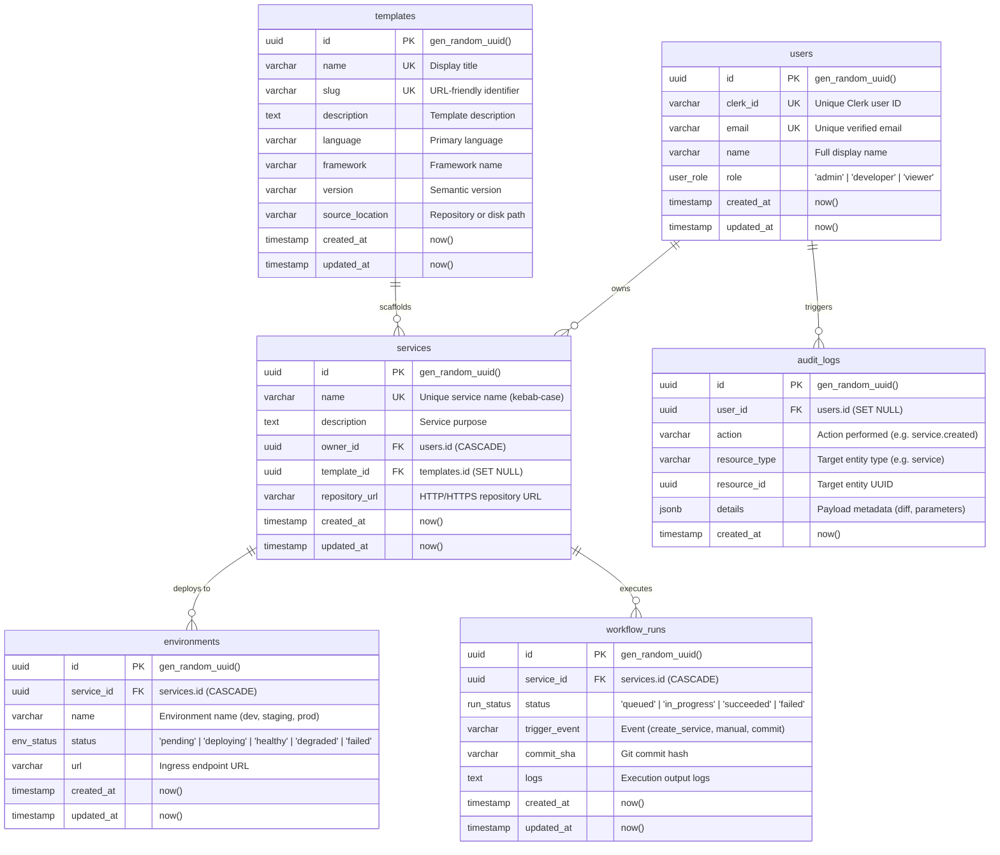

# ForgeFlow Architecture

## System Overview

ForgeFlow is an Internal Developer Platform (IDP) designed to streamline microservice scaffolding, repository provisioning, CI/CD automation, and deployment observability.

```text
+-------------------------------------------------------------+
|                      React Web Portal                       |
|               (Vite + Tailwind CSS + Clerk)                 |
+------------------------------+------------------------------+
                               | HTTPS / JSON (camelCase)
                               v
+-------------------------------------------------------------+
|                    Express API Gateway                      |
|  - Clerk JWT Authentication & User Sync                     |
|  - Server-Side Role-Based Access Control (RBAC)             |
|  - Zod Request Validation (@forgeflow/shared-types)         |
|  - Structured Audit Logging                                 |
+------------------------------+------------------------------+
                               | SQL / Drizzle ORM
                               v
+-------------------------------------------------------------+
|                    PostgreSQL Database                      |
|  (users, templates, services, environments, runs, audits)   |
+-------------------------------------------------------------+
```

---

## Database Architecture (Phase 1)

ForgeFlow utilizes PostgreSQL managed via **Drizzle ORM**. The platform schema consists of six core relational tables:



### Foreign Key & Cascade Relationships

- **`services.owner_id`**: References `users.id` with `ON DELETE CASCADE`. If a user is deleted, their owned services are deleted.
- **`services.template_id`**: References `templates.id` with `ON DELETE SET NULL`. If a template is decommissioned, existing services retain their catalog identity.
- **`environments.service_id`**: References `services.id` with `ON DELETE CASCADE`. Deleting a service purges all associated deployment environments.
- **`workflow_runs.service_id`**: References `services.id` with `ON DELETE CASCADE`. Deleting a service purges execution logs.
- **`audit_logs.user_id`**: References `users.id` with `ON DELETE SET NULL`. Audit records are preserved for security compliance even if an actor account is deleted.

---

## Authentication & Authorization Model

ForgeFlow implements a decoupled identity and authorization architecture:

1. **Authentication Provider**: Clerk handles authentication, session tokens, and identity lifecycle.
2. **Identity Verification**:
   - The API server verifies incoming Bearer JWT tokens via `clerkMiddleware()`.
   - The verified `userId` is used to fetch the user profile directly from the Clerk backend via `clerkClient.users.getUser(userId)`.
   - The primary email address is inspected: only email addresses with `verification.status === 'verified'` are trusted.
3. **Just-In-Time (JIT) Provisioning**:
   - `syncClerkUser` provisions or updates the internal `users` record using an atomic `INSERT ... ON CONFLICT (clerk_id) DO UPDATE`.
   - Normalization: emails are lowercased and trimmed.
   - Collision protection: if an email is already associated with another `clerk_id`, the API returns a `409 Conflict`.
4. **Role-Based Access Control (RBAC)**:
   - **`admin`**: Full platform authority. Can create, read, update, and delete any service, trigger builds, and view system logs. Granted automatically to verified users whose emails match `ADMIN_EMAILS`.
   - **`developer`**: Can view catalog, create new services, and edit or delete services they own (`services.owner_id === users.id`).
   - **`viewer`**: Read-only access across the catalog and platform metrics. Cannot create, edit, or delete services.
   - **No Automatic Demotion**: Once a user is an `admin` or `developer`, subsequent logins do not demote them to `viewer`, preventing race conditions and administrative lockouts.
