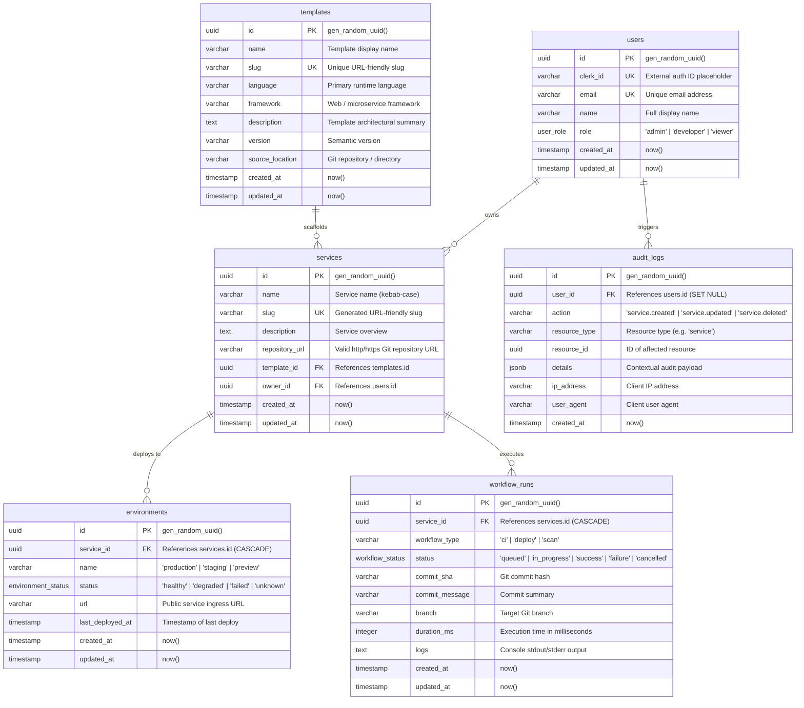
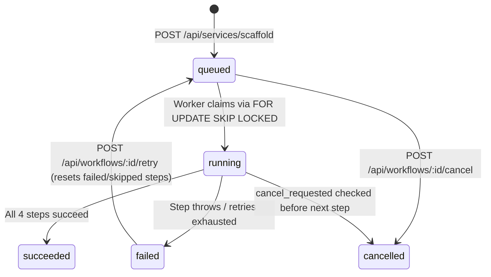
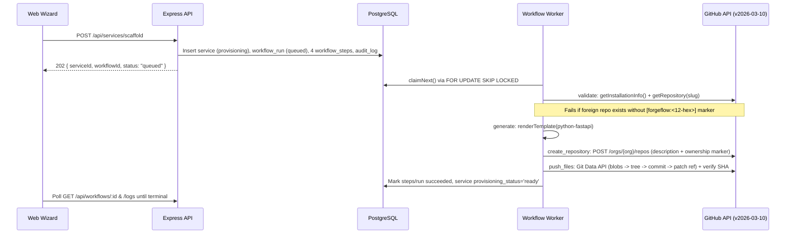

# ForgeFlow Architecture

## System Overview

ForgeFlow is an Internal Developer Platform (IDP) designed to streamline microservice scaffolding, repository provisioning, CI/CD automation, and deployment observability.

```text
+-------------------------------------------------------------+
|                      React Web Portal                       |
|          (Vite + Tailwind CSS + TanStack Query)             |
+------------------------------+------------------------------+
                               | HTTP / JSON (camelCase)
                               v
+-------------------------------------------------------------+
|                    Express API Gateway                      |
|  - Local Admin Auth Verifier (Development Mode)             |
|  - Server-Side Role-Based Access Control (RBAC)             |
|  - Zod Request Validation (@forgeflow/shared-types)         |
|  - Structured Audit Logging                                 |
+------------------------------+------------------------------+
                               | SQL / Drizzle ORM
                               v
+-------------------------------------------------------------+
|                    PostgreSQL Database                      |
|  (users, templates, services, environments, runs, audits)   |
+-------------------------------------------------------------+
```

---

## Authentication Architecture

ForgeFlow currently operates in **local development mode**:

- Single built-in local administrator user (`Local Admin`, `admin@forgeflow.local`, role: `admin`).
- Express server binds to `127.0.0.1` and fails startup if `NODE_ENV === 'production'`.
- Database schema retains `users.clerk_id` as an external-auth identity placeholder column (`local-admin`).
- Production Clerk authentication has been saved under git tag `phase-1-clerk` and will be reintroduced alongside enterprise SSO options.

---

## Database Architecture (Phase 1)

ForgeFlow utilizes PostgreSQL managed via **Drizzle ORM**. The platform schema consists of six core relational tables:



---

## Phase 2 Workflow Engine & GitHub Integration

### Workflow State Machine



### Queue & Worker Execution

- **Queue Claiming**: `claimNext(workerId)` selects the oldest `queued` run using PostgreSQL `FOR UPDATE SKIP LOCKED`, transitions it to `running`, increments `attempts`, and sets `locked_at` / `locked_by`.
- **Heartbeat & Stale-Lock Recovery**: While executing steps, the worker refreshes `locked_at` every 15s (`LOCK_HEARTBEAT_MS`). On startup and every 30s, `requeueStale()` recovers any `running` run whose `locked_at` is older than 60s (`STALE_LOCK_MS`), returning it to `queued` (or `failed` if `attempts >= maxAttempts`).
- **Cancellation**: `POST /api/workflows/:id/cancel` cancels `queued` runs immediately or sets `cancel_requested = true` on `running` runs so the executor stops cleanly before starting the next step.

### GitHub Integration Sequence


